## Hey! 👋

I'm **Alessandro**, a student at the Apple Developer Academy. I make Mac and iPhone apps in Swift.

---

# 🛠 What I'm building

### 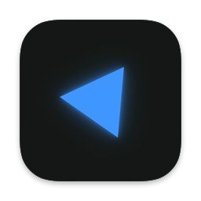 [ByeClicky](https://github.com/AleSignorile12/ByeClicky)

A little assistant that sits next to your cursor. You hold Control + Option, ask it something, and
it looks at your screen and points at the right button. It runs locally with Ollama, so nothing
leaves your Mac.

*Swift · SwiftUI · ScreenCaptureKit · Speech · Ollama*

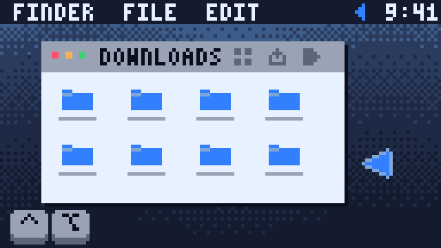

### 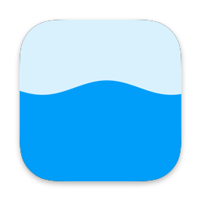 [Senso](https://github.com/AleSignorile12/Senso)

An iPhone and Apple Watch app that helps blind and low-vision people pour a drink without
overflowing the cup. It listens to the pour with an on-device sound model, says how full the glass
is as you go, and tells you when to stop.

*SwiftUI · Core ML · AVFoundation · App Intents · watchOS*

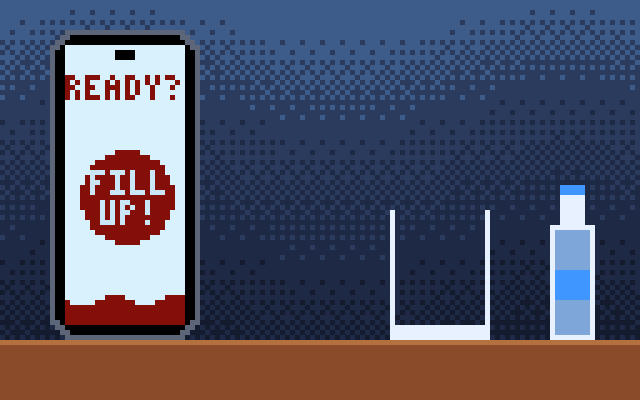

###  [Dynisland](https://github.com/AleSignorile12/Dynisland)

A Dynamic Island for the MacBook notch: what's playing, a shelf for files, timers, that kind of
thing. Still working on it.

*Swift · AppKit · SwiftUI · Core Audio*

### 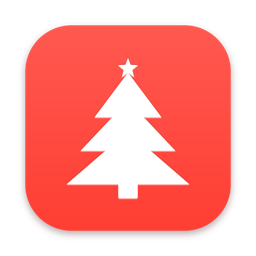 [X-Snow](https://github.com/AleSignorile12/X-Snow)

A menu bar app that makes it snow on your Mac. The snow piles up on top of your windows and along
the Dock, and you can put out trees and snowmen, hang lights, send a little plow along a window,
and wait for Santa to fly by.

*Swift · AppKit · SpriteKit*

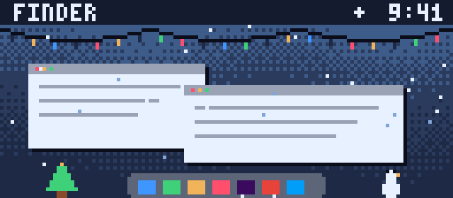

### 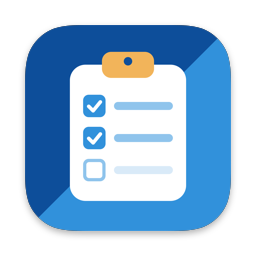 [Tracker](https://github.com/AleSignorile12/Tracker)

An iPhone app for coaching kids: the team list, who's paid this month, which documents are still
missing, birthdays, and an offline translator for talking with kids who speak another language.

*SwiftUI · SwiftData · on-device translation with ML Kit*

### 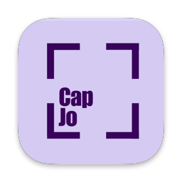 [CapJo](https://github.com/AleSignorile12/CapJo)

A photo journal with one small challenge a day, like "a tree near you". You take the picture in the
app, add an emoji and a caption, and it lands in your journal as a polaroid. Made with my team at
the Apple Developer Academy.

*SwiftUI · AVFoundation · UserNotifications*

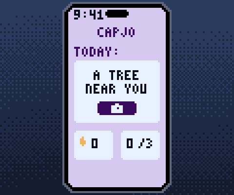

### 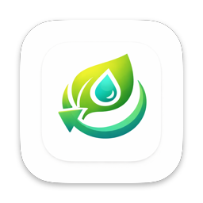 [AquaSave](https://github.com/AleSignorile12/AquaSave-V2.0)

An iPhone app for a family of small water sensors that clip onto taps and shower heads. It learns
your home's usual day, sets a daily limit that slowly steps down, and pays credits for every liter
you save. The sensors don't exist yet, so for now it runs on simulated readings.

*SwiftUI · SwiftData · Swift Charts · WidgetKit*

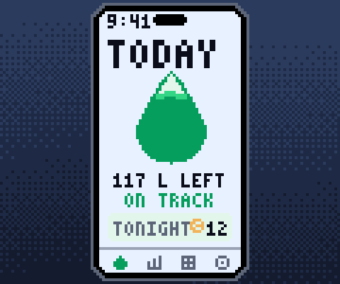

---

# 💻 Tech stack

           
