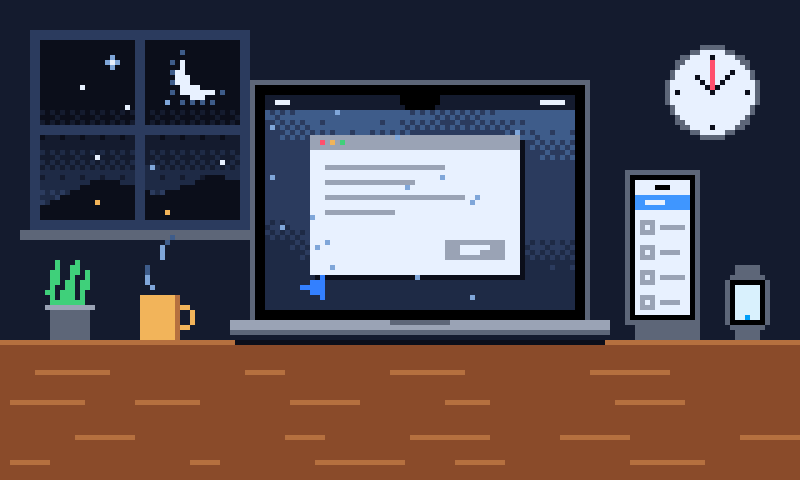
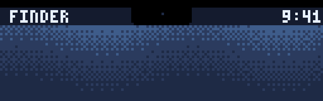
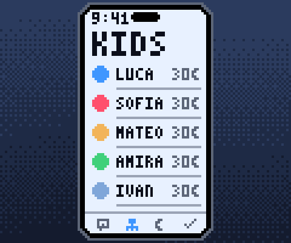

My desk at night, in pixels. ByeClicky is the blue cursor on the Mac, Dynisland lives in the
notch and Tracker is on the phone. Drawn from code with a small Python script, no libraries
([source](art/make_art.py)).

## Hey! 👋

I'm **Alessandro**, a student at the Apple Developer Academy. I make Mac and iPhone apps in Swift.

---

# 🛠 What I'm building

###  [ByeClicky →](https://github.com/AleSignorile12/ByeClicky)

A little assistant that sits next to your cursor. You hold Control + Option, ask it something, and
it looks at your screen and points at the right button. It runs locally with Ollama, so nothing
leaves your Mac.

*Swift · SwiftUI · ScreenCaptureKit · Speech · Ollama*

###  Dynisland

A Dynamic Island for the MacBook notch: what's playing, a shelf for files, timers, that kind of
thing. Still working on it.

*Swift · AppKit · SwiftUI · Core Audio*

###  Tracker

An iPhone app for coaching kids: the team list, who's paid this month, which documents are still
missing, birthdays, and an offline translator for talking with kids who speak another language.

*SwiftUI · SwiftData · on-device translation with ML Kit*

---

# 💻 Tech stack

        
